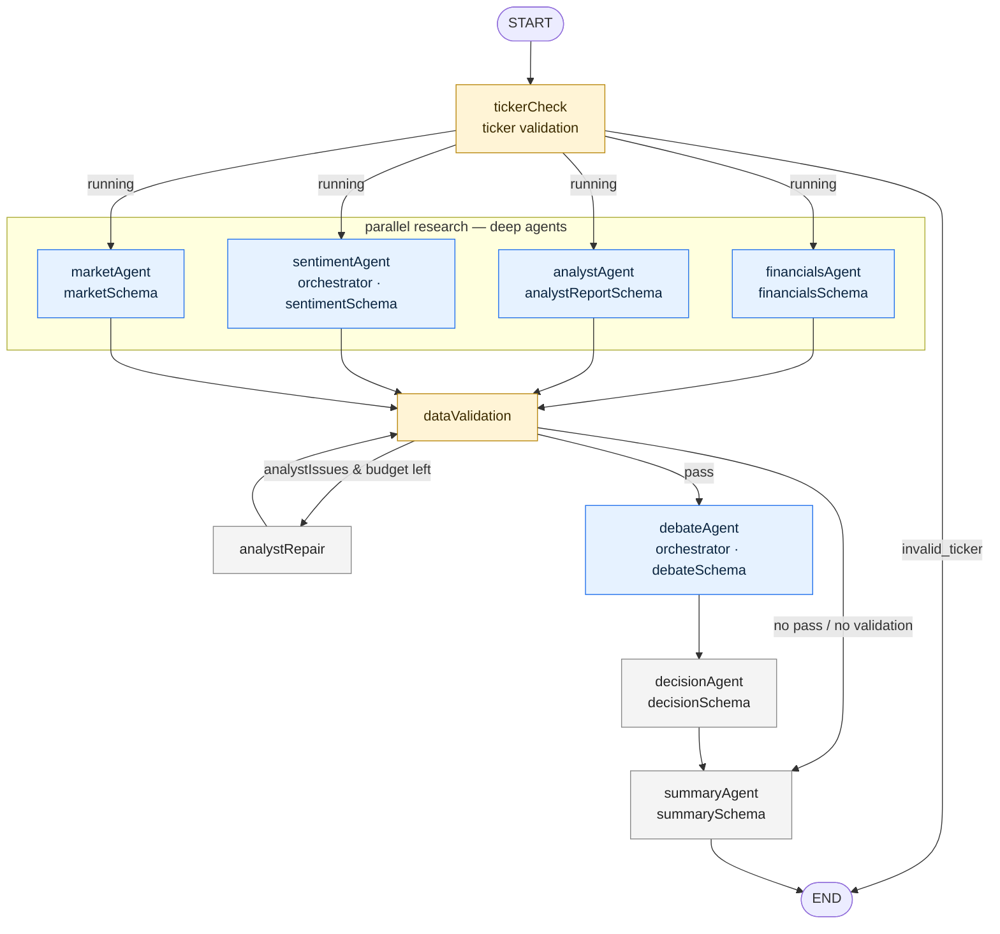
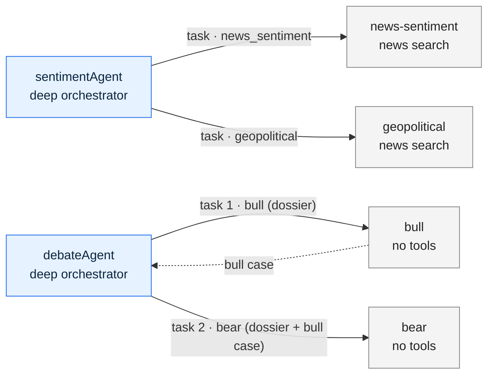
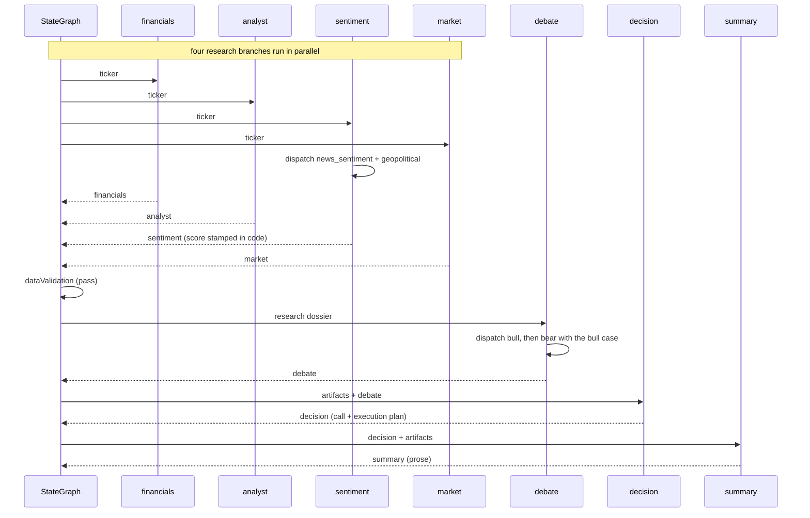

# Workflow

Diagrammatic companion to [ARCHITECTURE.md](ARCHITECTURE.md). The authoritative
edges live in `src/workflows/graph.ts`; this file is the picture, not the spec.

The diagrams are written in [Mermaid](https://mermaid.js.org/). GitHub renders
them inline; in VS Code install a Mermaid extension (or use the Markdown
preview) to see them.

## The graph

One explicit `StateGraph`. Four research branches fan out in parallel, the
validation node gates them, and the debate → decision → summary chain runs once.

## Subagent delegation

The two orchestrators hold no tools. They dispatch native subagents through the
`task` tool and copy the returned evidence into their own structured output.

## Sequence of a passing run

## State channels

Written by the node(s) named; read by downstream nodes. Names intentionally
differ from the node names (`tickerCheck` → `tickerValidation`).

| Channel                           | Writer                          | Reader                                |
| --------------------------------- | ------------------------------- | ------------------------------------- |
| `ticker`                          | caller (input)                  | every research node, validation       |
| `tickerValidation`                | `tickerCheck`                   | router                                |
| `financials`                      | `financialsAgent`               | validation, debate, decision, summary |
| `analyst`                         | `analystAgent`, `analystRepair` | validation, debate, decision, summary |
| `sentiment`                       | `sentimentAgent`                | validation, debate, decision, summary |
| `market`                          | `marketAgent`                   | validation, debate, decision, summary |
| `validation` / `validationIssues` | `dataValidation`                | router                                |
| `analystAttempts`                 | `analystRepair`                 | router                                |
| `debate`                          | `debateAgent`                   | decision, summary                     |
| `decision`                        | `decisionAgent`                 | summary, report                       |
| `summary`                         | `summaryAgent`                  | report                                |
| `workflowStatus`                  | several                         | router                                |
